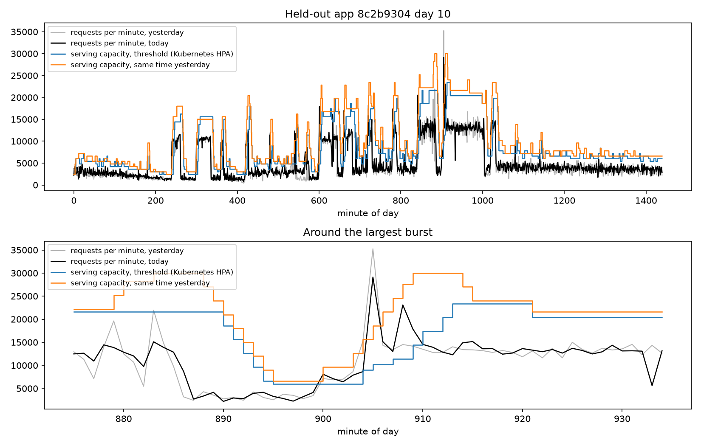

# rl-autoscaler

Can a reinforcement learning (RL) policy keep fewer requests waiting than the Kubernetes autoscaler, at the same cost, by learning when to keep spare servers? Humanitarians AI RL Environments project.

## Problem

Threshold autoscalers, such as the Kubernetes Horizontal Pod Autoscaler (HPA), react to load after it arrives, and new servers take minutes to boot. In real traffic most bursts jump in a single minute, so no policy can react to them in time: the only defence is spare capacity. But many bursts repeat at the same time each day, so a policy can learn when spare capacity pays off.

## Data

Real traffic comes from the [Azure Functions Trace 2019](https://github.com/Azure/AzurePublicDataset) (Shahrad et al., USENIX ATC 2020), licensed [CC-BY 4.0](https://github.com/Azure/AzurePublicDataset/blob/master/LICENSE). [prepare_azure.py](scripts/prepare_azure.py) sums the HTTP-triggered functions of each app per minute and keeps 19 busy apps that vary (rule in [the metadata](data/azure2019_http_apps.json)); ids are shortened. 14 apps are for training (days 1-10); unseen days 11-14 and 5 held-out apps are for testing.

Measured on the training days: per-minute noise around 15%, about 24 bursts per app per day, and 72% of bursts peak in their first minute. The synthetic generator ([traffic.py](src/rl_autoscaler/traffic.py)) copies these statistics from one real app per episode (daily shape, noise, burst sizes, lengths, ramps, and how often a burst repeats the next day) and draws new noise and bursts.

## Approach

- `AutoscaleEnv` ([env.py](src/rl_autoscaler/env.py)) is a Gymnasium environment. One step is one minute. The agent adds or removes up to 5 servers (600 requests per minute each); new servers serve after a 3-minute boot delay but are billed at once. Requests not served in the minute they arrive are late; past 2 minutes of queue they are dropped. Each episode is two days: the agent acts on the second and can see the first.
- Observation: the last 10 minutes of load, yesterday's load for the next 10 minutes, running and booting servers, queue size, time of day.
- Reward: minus server cost, minus a penalty per late request.
- Baselines ([policies.py](src/rl_autoscaler/policies.py)): a fixed count sized for the day's peak; the HPA rule (70% target, 10% tolerance, 5-minute scale-down window); the same rule on a linear-trend forecast; the same rule on a "same time yesterday" forecast.

## Results so far

Five held-out apps, 65 unseen days (`python scripts/demo.py`):

| Policy | Server-minutes per day | Late requests |
|---|---|---|
| Fixed, sized for the day's peak | 39,445 | 0.07% |
| Threshold (Kubernetes HPA) | 19,986 | 5.47% |
| Linear forecast | 22,858 | 4.63% |
| Same time yesterday | 24,488 | 1.17% |



Spare servers alone do not explain the gap: the threshold rule at a 50% target costs more (27,371 server-minutes per day) and is still late 3.10% of the time. Daily repetition is the signal to learn, so the RL policy has to beat "same time yesterday" at equal cost.

## Run

```bash
python3.11 -m venv .venv && source .venv/bin/activate
pip install -e '.[dev]'
pytest
python scripts/demo.py
```

The processed data is in `data/`. To rebuild it, download the trace into `data/raw/azure2019`, `pip install -e '.[data]'`, and run `python scripts/prepare_azure.py`.

## Plan

- Week of 2 Nov: environment, baselines, real traffic, fitted synthetic traffic, tests (done).
- Week of 9 Nov: PPO with Stable-Baselines3 in Colab, trained on fitted synthetic and real training days.
- Week of 16 Nov: reward tuning; cost against late requests across reward weights; boot delays of 1, 3 and 5 minutes.
- Week of 23 Nov: final tests on unseen days and held-out apps, report, `SKILL.md`.
